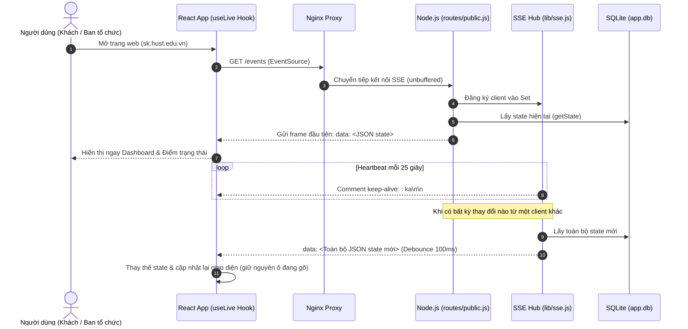
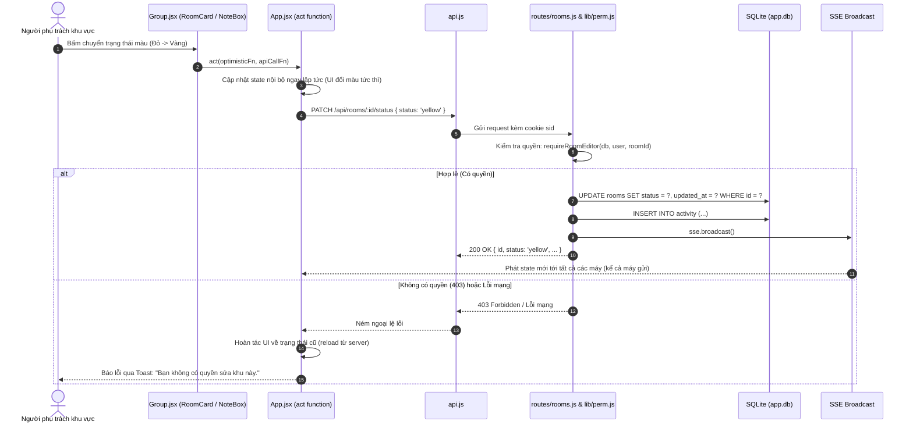
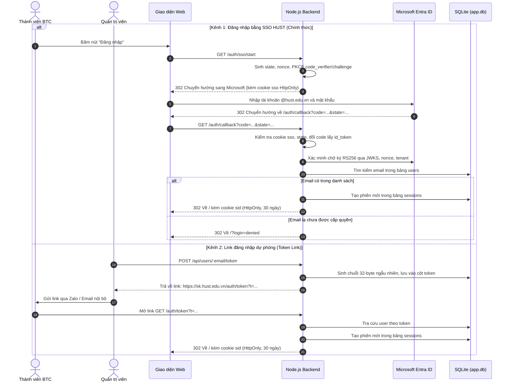
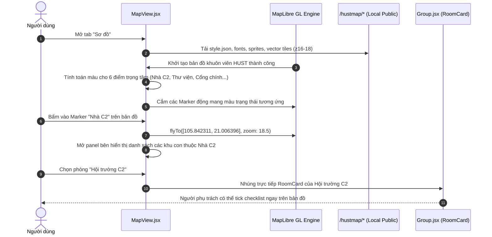

# Bản đồ Kiến trúc Hệ thống (Architecture Codemap)

> **Dự án:** Event Tracker (Tác chiến khẩn cấp theo dõi sự kiện)  
> **Phiên bản:** 1.0.0 (Nhánh `main` tích hợp nhánh `minh`)  
> **Cập nhật lần cuối:** 2026-10-12  
> **Điểm vào chính (Entry Points):**  
> - Backend: `server.js` (HTTP daemon)  
> - Frontend: `web/src/main.jsx` -> `web/src/App.jsx` (SPA React 18)  
> - Bản đồ số: `web/public/hustmap/style.json` (HUSTMAP Offline MapLibre Assets)

---

## 1. Sơ đồ Kiến trúc Tổng thể (System Architecture)

```mermaid
graph TD
    subgraph Client ["Client Devices (Mobile-first & Desktop)"]
        Browser["Trình duyệt (Chrome / Safari / Zalo)"]
        ReactApp["React 18 SPA (web/src)"]
        Browser --> ReactApp
    end

    subgraph ReverseProxy ["Reverse Proxy & Web Server"]
        Nginx["Nginx (Cổng 80/443)"]
        StaticAssets["Tệp tĩnh /dist & /hustmap (Cache)"]
    end

    subgraph BackendApp ["Node.js 22 LTS Runtime (Zero External Deps)"]
        Server["server.js (Cổng 3000)"]
        Router["lib/http.js (Mini Router)"]
        AuthModule["auth/sso.js & auth/token.js"]
        PermModule["lib/perm.js (RBAC Middleware)"]
        RepoModule["lib/repo.js & lib/validate.js"]
        SSEHub["lib/sse.js (EventSource Hub)"]
        SessionMgr["lib/session.js (HttpOnly Cookie)"]
    end

    subgraph Storage ["Cơ sở dữ liệu SQLite"]
        SQLite[("app.db (node:sqlite WAL mode)")]
        SeedJSON["seed.json (Initial Seed)"]
    end

    subgraph ExternalServices ["Dịch vụ Bên ngoài"]
        EntraID["Microsoft Entra ID (HUST SSO OIDC)"]
    end

    ReactApp -->|HTTP REST: /api/*, /auth/*| Nginx
    ReactApp -->|SSE Stream: /events| Nginx
    ReactApp -->|Tải tệp tĩnh & Vector Tiles: /hustmap/*| Nginx

    Nginx -->|Proxy Pass (buffering off)| Server
    Nginx -->|Phục vụ trực tiếp| StaticAssets

    Server --> Router
    Router --> AuthModule
    Router --> PermModule
    Router --> RepoModule
    Router --> SSEHub
    Router --> SessionMgr

    AuthModule <-->|OIDC Authorization Code + PKCE| EntraID
    RepoModule <-->|SQL Prepared Statements / Transactions| SQLite
    SessionMgr <-->|Lưu trữ phiên 30 ngày| SQLite
    Server -.->|Nạp dữ liệu lần đầu| SeedJSON
    RepoModule -->|Phát tín hiệu thay đổi| SSEHub
    SSEHub -->|Push toàn bộ state mới <100ms| ReactApp
```

---

## 2. Bản đồ Module Backend

Backend được thiết kế với triết lý **Zero External Dependencies** — chỉ sử dụng các module tích hợp sẵn trong Node.js 22 LTS (`node:http`, `node:sqlite`, `node:crypto`, `node:fs`, `node:url`).

### 2.1 Bảng phân tích các module Backend

| Module | Mục đích chính | Xuất khẩu chính (Exports) | Phụ thuộc nội bộ |
|---|---|---|---|
| `server.js` | Khởi động server HTTP, nạp cấu hình môi trường, khởi tạo DB, nạp seed ban đầu và quản lý graceful shutdown. | — (Entrypoint) | `lib/db.js`, `lib/app.js`, `lib/seed.js` |
| `lib/app.js` | Factory tạo ứng dụng `createApp`, gắn router, kiểm tra header Origin, phân luồng request, xử lý lỗi tập trung. | `createApp` | `lib/db.js`, `lib/http.js`, `lib/session.js`, `lib/sse.js`, `routes/*` |
| `lib/db.js` | Quản lý kết nối SQLite bằng `node:sqlite` (`DatabaseSync`), khởi tạo bảng, hàm `getState()` định dạng dữ liệu cho dashboard. | `openDb`, `getState` | `node:sqlite` |
| `lib/repo.js` | Các hàm truy vấn thực thể kèm bắt lỗi 404 (`roomOr404`, `taskOr404`, `groupOr404`), hàm bọc transaction `tx()`, ghi nhật ký `logActivity()`, format views. | `roomOr404`, `taskOr404`, `groupOr404`, `tx`, `logActivity`, `roomView`, `taskView` | `lib/http.js`, `lib/validate.js` |
| `lib/perm.js` | Kiểm tra quyền truy cập (RBAC): `requireUser`, `requireAdmin`, `canEditRoom`, `requireRoomEditor`. | `requireUser`, `requireAdmin`, `canEditRoom`, `requireRoomEditor` | `lib/http.js` |
| `lib/session.js` | Quản lý phiên cookie `sid` 32-byte ngẫu nhiên, gắn cookie `HttpOnly` / `SameSite=Lax` / `Secure`, dọn dẹp phiên hết hạn (TTL 30 ngày). | `parseCookies`, `sidFrom`, `createSession`, `getUser`, `destroySession`, `purgeExpired`, `setSessionCookie`, `clearSessionCookie` | `node:crypto` |
| `lib/sse.js` | Quản lý danh sách kết nối SSE clients, gửi heartbeat keep-alive (`: ka\n\n`) mỗi 25s, debounce broadcast 100ms. | `createSse` | — |
| `lib/http.js` | Router mini tùy biến, lớp `HttpError`, hàm đọc JSON giới hạn dung lượng `readJson`, kiểm tra bảo vệ `checkOrigin`. | `HttpError`, `send`, `readJson`, `createRouter`, `checkOrigin` | — |
| `lib/validate.js` | Xác thực dữ liệu đầu vào (độ dài text, email, integer, giá trị enum trạng thái). | `text`, `int`, `toInt`, `email`, `oneOf`, `STATUSES`, `TASK_STATES` | `lib/http.js` |
| `lib/seed.js` | Nạp dữ liệu khởi tạo từ `seed.json` vào database SQLite và tự động gán token dự phòng cho các tài khoản. | `isEmpty`, `applySeed`, `ensureTokens` | `auth/token.js` |
| `routes/public.js` | Đăng ký route công khai: `GET /api/state`, `GET /events` (SSE). | `registerPublic` | `lib/db.js` |
| `routes/auth.js` | Đăng ký route xác thực: `GET /api/me`, `GET /auth/token`, `POST /auth/logout`, `GET /auth/sso/start`, `GET /auth/callback`. | `registerAuth` | `lib/http.js`, `lib/session.js`, `auth/token.js`, `auth/sso.js` |
| `routes/rooms.js` | Đăng ký route cập nhật hiện trường: đổi màu khu, đổi note, đổi trạng thái việc, thêm/xóa việc trong khu. | `registerRooms` | `lib/http.js`, `lib/perm.js`, `lib/repo.js`, `lib/validate.js` |
| `routes/admin.js` | Đăng ký route quản trị: CRUD khối, CRUD khu, gán người phụ trách, CRUD người dùng, tạo lại link token. | `registerAdmin` | `lib/http.js`, `lib/perm.js`, `lib/repo.js`, `lib/validate.js`, `auth/token.js` |
| `auth/token.js` | Cơ chế đăng nhập bằng magic token link: sinh token `base64url`, tra cứu người dùng theo token. | `newToken`, `loginUrl`, `userByToken` | `node:crypto` |
| `auth/sso.js` | Cơ chế đăng nhập SSO Microsoft Entra ID (OIDC + PKCE): tạo challenge, kiểm tra callback, xác minh RS256 JWKS, claim verification. | `ssoStart`, `ssoCallback` | `node:crypto`, `lib/session.js` |

---

## 3. Bản đồ Module Frontend

Frontend được xây dựng bằng **React 18** và **Vite**, không sử dụng thư viện UI nặng nề để đảm bảo bundle nhỏ gọn, tải nhanh trên mạng 3G/4G hiện trường.

### 3.1 Bảng phân tích các module Frontend (`web/src/`)

| Module | Mục đích chính | Thành phần / Hàm xuất | Phụ thuộc |
|---|---|---|---|
| `web/src/main.jsx` | Điểm khởi đầu của ứng dụng React, mount component `<App />` vào DOM. | — | `react`, `react-dom/client`, `App.jsx`, `styles.css` |
| `web/src/App.jsx` | Điều phối state toàn cục, routing qua hash (`useHash`), quản lý chế độ hiển thị (`overview`, `mine`, `status`, `group`, `map`), thanh tìm kiếm, toast thông báo, cập nhật lạc quan `act()`. | `default export App` | `api.js`, `useLive.js`, `logic.js`, `Sidebar.jsx`, `Header.jsx`, `Group.jsx`, `Manage.jsx`, `MapView.jsx` (lazy) |
| `web/src/Sidebar.jsx` | Thanh điều hướng bên (drawer trên mobile): chuyển mode, danh sách khối, bộ lọc nhanh 3 màu, thanh tiến độ tổng thể, thông tin tài khoản và đăng nhập/đăng xuất. | `default export Sidebar` | `lucide-react`, `logic.js` |
| `web/src/Header.jsx` | Thanh công cụ trên cùng cố định (topbar): nút mở menu mobile, tiêu đề tiến độ, ô tìm kiếm debounce, chỉ báo kết nối realtime (`Wifi`/`WifiOff`), hàng chip lọc nhanh. | `default export Header` | `lucide-react`, `logic.js` |
| `web/src/Group.jsx` | Hiển thị khối sự kiện (`GroupCard`) và thẻ khu vực (`RoomCard`). Tích hợp `NoteBox` chống ghi đè khi đang gõ và `AddTask` thêm việc nhanh. Hỗ trợ cơ chế thu gọn/mở rộng thẻ khu vực. | `default export GroupCard`, `RoomCard` | `lucide-react`, `api.js`, `logic.js` |
| `web/src/MapView.jsx` | Bản đồ khuôn viên HUST tích hợp: render MapLibre GL với style vector ngoại tuyến, marker động theo trạng thái khu, tương tác xem danh sách khu và thao tác checklist trực tiếp trên panel bên. | `default export MapView` | `maplibre-gl`, `lucide-react`, `Group.jsx` |
| `web/src/Manage.jsx` | Giao diện quản trị toàn diện dành cho Admin (`#/manage`): thêm/sửa/xóa khối và khu vực, tick chọn người phụ trách, quản lý danh sách ban tổ chức, tạo và copy link đăng nhập dự phòng. | `default export Manage` | `lucide-react`, `api.js`, `logic.js` |
| `web/src/api.js` | Thư viện đóng gói các cuộc gọi API HTTP (`fetch`) tới backend với `credentials: 'same-origin'`. | `api` | — |
| `web/src/useLive.js` | Hook quản lý kết nối EventSource tới `/events`, tự động lấy state ban đầu, tự phục hồi khi mất kết nối, fallback fetch. | `useLive` | `api.js` |
| `web/src/logic.js` | Các hàm thuần túy (pure functions) tính toán tiến độ, đếm trạng thái, format thời gian tiếng Việt, kiểm tra quyền `canEdit`, cập nhật state bất biến (`patchRoom`, `patchTask`, `removeTask`). | `ST`, `TS`, `NEXT`, `canEdit`, `doneCount`, `percent`, `statusCounts`, `totals`, `patchRoom`, `patchTask`, `removeTask`, `timeLabel` | — |
| `web/src/styles.css` | Toàn bộ hệ thống giao diện CSS: biến màu chủ đạo, responsive grid/flex, animation, typography, giao diện bản đồ và sidebar. | — | — |

### 3.2 Tài nguyên Bản đồ Ngoại tuyến (`web/public/hustmap/`)

| Đường dẫn tệp / thư mục | Vai trò kỹ thuật |
|---|---|
| `style.json` | Tệp đặc tả cấu hình Style của MapLibre GL; định nghĩa các layer đường xá, tòa nhà, cây xanh và nguồn vector tiles. |
| `tiles/{z}/{x}/{y}.pbf` | Tập hợp các mảnh bản đồ vector nén (Protocol Buffers) tại các mức phóng to z16, z17, z18 phủ kín khuôn viên Đại học Bách khoa Hà Nội. |
| `fonts/Montserrat*/*.pbf` | Phông chữ véc-tơ định dạng PBF theo từng dải ký tự (Unicode glyphs) giúp hiển thị nhãn địa danh tiếng Việt ngoại tuyến. |
| `sprite/sprite*` | Bộ ảnh chứa các icon ký hiệu bản đồ và tệp JSON mô tả vị trí sprite. |

---

## 4. Sơ đồ Luồng Dữ liệu (Data Flow)

### 4.1 Luồng Đọc Trạng thái & Đồng bộ Realtime (SSE)



### 4.2 Luồng Ghi Dữ liệu & Cập nhật Lạc quan (Optimistic UI)



### 4.3 Luồng Xác thực: Microsoft Entra ID SSO vs Link Dự phòng



### 4.4 Luồng Tương tác Bản đồ Số HUSTMAP Offline



---

## 5. Ràng buộc & Đặc tính Kỹ thuật Quan trọng

1. **Kiểm tra quyền phía Server:**
   - Server kiểm tra quyền ở **mọi** API ghi dữ liệu (`PATCH`, `POST`, `PUT`, `DELETE`).
   - Giao diện người dùng ẩn các nút điều khiển chỉ nhằm mục đích tối ưu trải nghiệm, **không** dùng để bảo mật.
2. **Nguyên tử hóa dữ liệu (Atomic Updates):**
   - Mọi thao tác cập nhật trạng thái hoặc checklist là một câu lệnh `UPDATE` hoặc `INSERT` đơn lẻ trong transaction SQLite `BEGIN IMMEDIATE`, cam kết không có hiện tượng xung đột khi nhiều người sửa đồng thời.
3. **Phòng chống tấn công:**
   - **XSS:** Toàn bộ ghi chú, tên khu và nội dung công việc được escape tự động qua React DOM khi render, lưu trữ nguyên bản trong cơ sở dữ liệu.
   - **CSRF / Origin spoofing:** Kiểm tra header `Origin` ở mọi request có phương thức thay đổi dữ liệu (`lib/http.js:checkOrigin`).
   - **Cookie Protection:** Cookie phiên `sid` luôn có cờ `HttpOnly; SameSite=Lax`, tự động bổ sung cờ `Secure` khi có header `X-Forwarded-Proto: https`.
4. **Offline Capability cho Bản đồ:**
   - Thư mục `web/public/hustmap` độc lập hoàn toàn với internet. Thao tác zoom trong phạm vi z16–z18 không tạo bất kỳ kết nối nào ra ngoài mạng LAN / máy chủ.

---

## 6. Danh mục Liên kết Tài liệu Liên quan

- [README.md](../../README.md): Hướng dẫn khởi động nhanh và tổng quan dự án.
- [TECH.md](../../TECH.md): Thiết kế kỹ thuật chi tiết và thông số cấu hình server.
- [API.md](../../API.md): Hợp đồng giao tiếp API REST giữa Backend và Frontend.
- [docs/SSO.md](../SSO.md): Chi tiết xác thực Microsoft Entra ID.
- [docs/TESTING.md](../TESTING.md): Sổ tay ca kiểm thử và báo cáo chất lượng.
- [docs/USECASES.md](../USECASES.md): Mô tả chi tiết các ca sử dụng của hệ thống.
